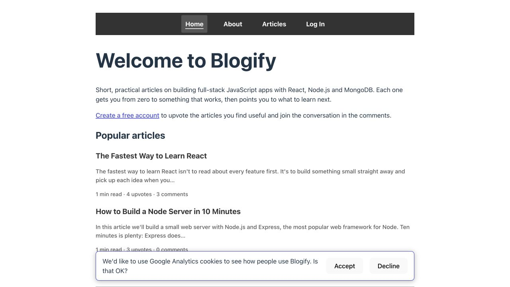
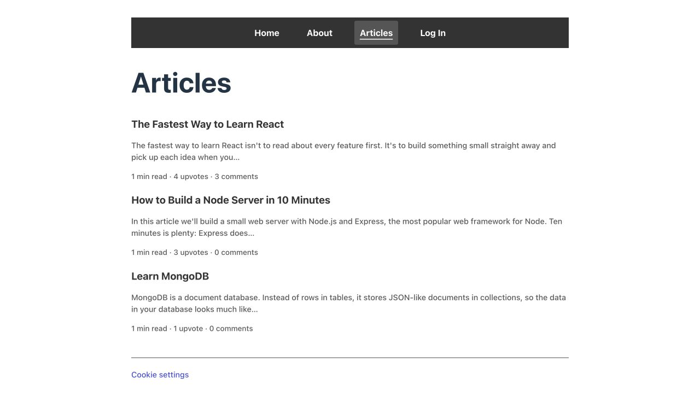
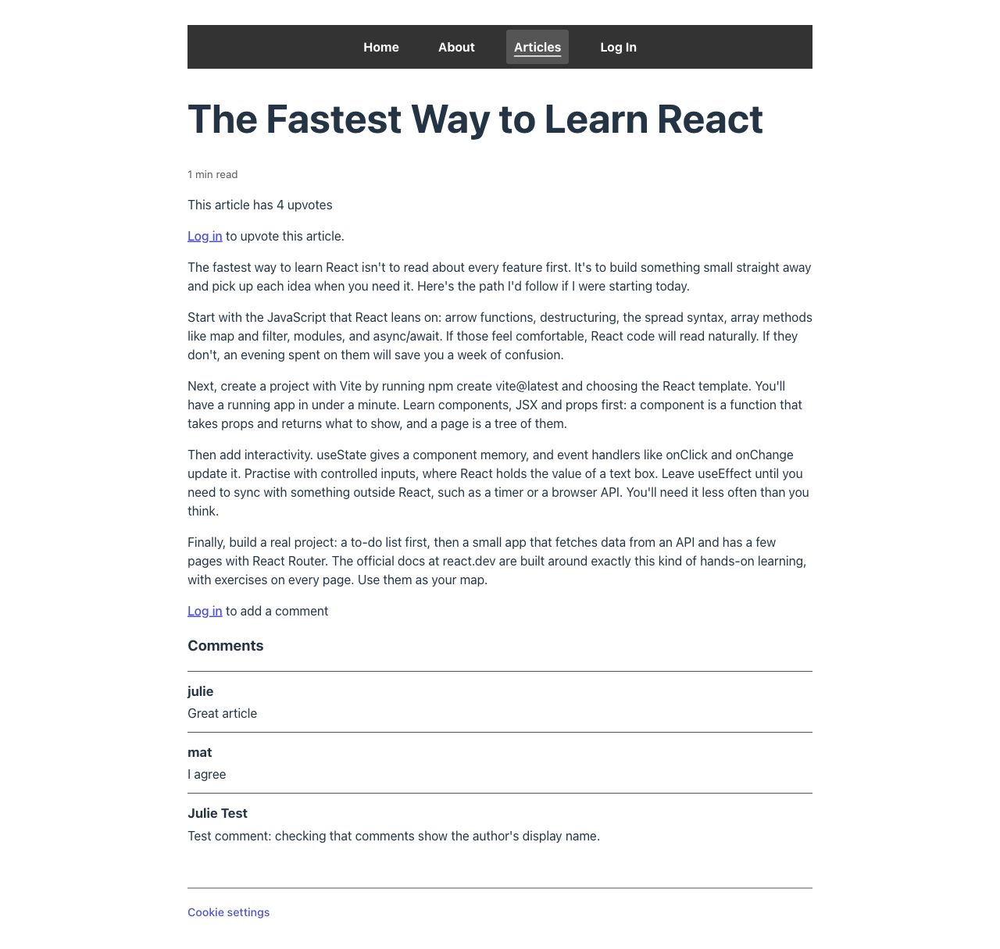
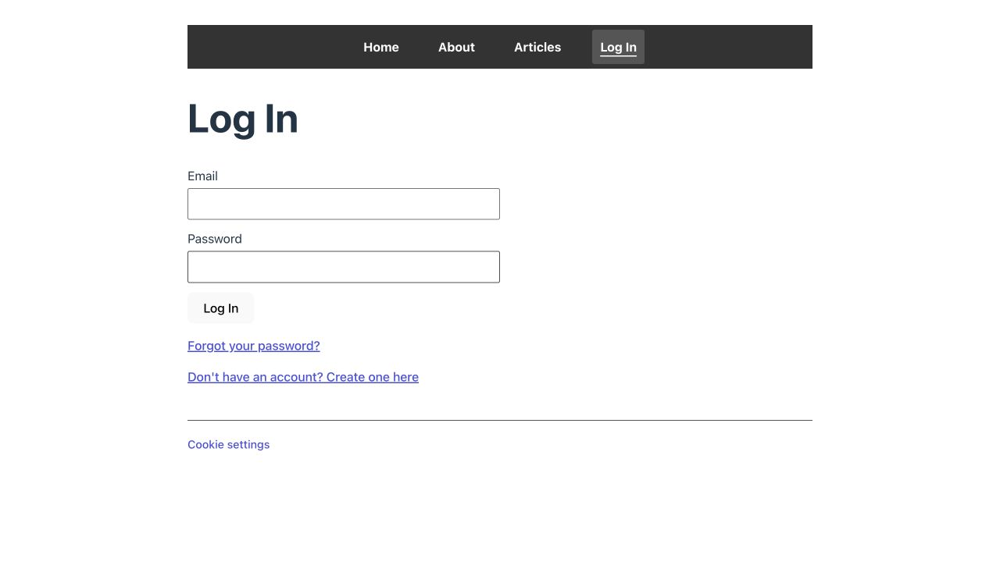
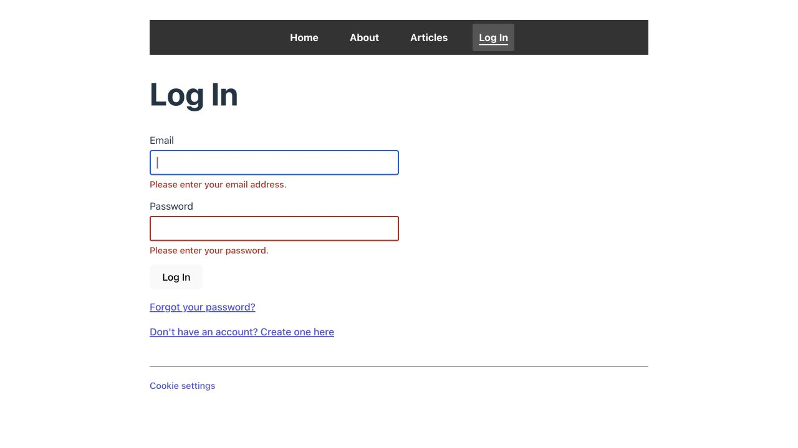
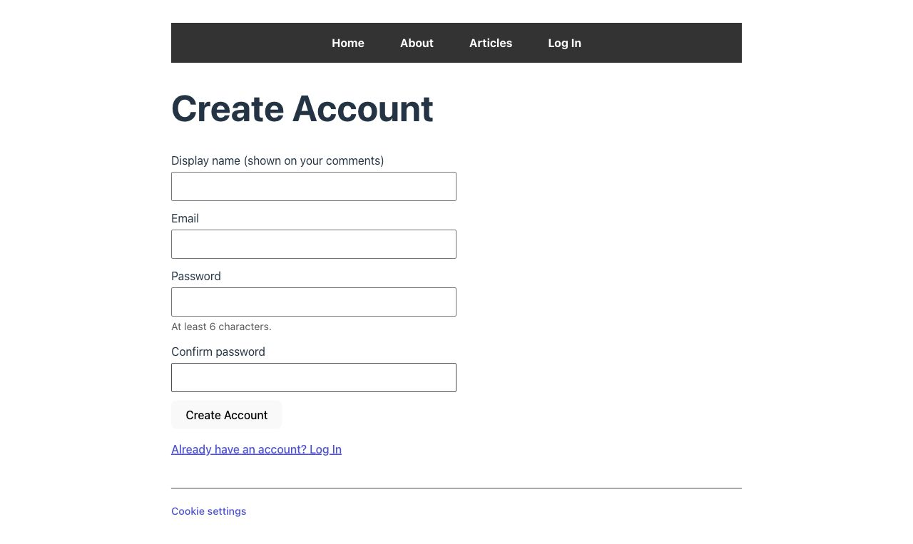
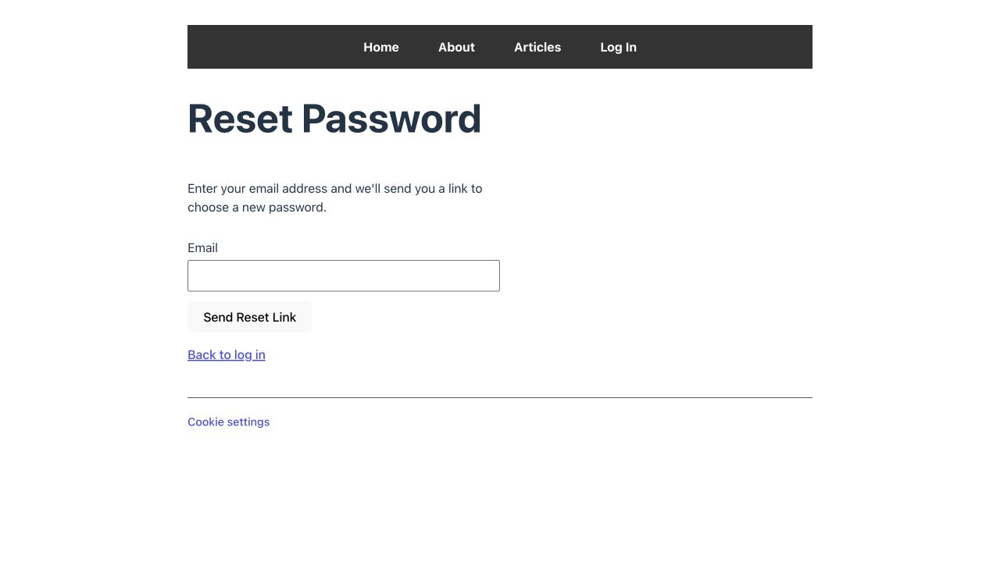

# Blogify UX and accessibility audit

Date: 16 October 2026
Source: https://app.ronirachmani.com/

## Verdict and scope
The public reader journey is straightforward and readable. No blocking navigation problem appeared in the observed path. The largest opportunities concern continuity into account entry, article usefulness, and trust. This is a combined UX and accessibility review of the public journey, not an end-to-end authenticated audit.

Goal: discover a practical JavaScript article, read it, and find how to join its conversation. Desktop captures used 1280×720; mobile home used 390×844. Screenshots are from this run and were saved and inspected individually.

## Prioritized recommendations

1. **Medium — preserve article context through authentication (steps 3–5).** Clicking the comment login prompt opens a generic /login page. The form shows no article title, back-to-article link, or promise to return. Add “Log in to comment on The Fastest Way to Learn React,” keep the intended destination through signup, and return to the comment area after authentication. The observed issue is missing context; successful redirect behavior was not tested.
2. **Medium — make article instructions usable and give readers a next step (step 3).** The Vite command and React API names look like ordinary prose; react.dev is plain text. Use code styling for commands and APIs, link the documentation, and add a related article or explicit return-to-list action after the article. Global Articles navigation remains available.
3. **Medium — remove public test content and improve provenance (step 3).** A comment explicitly describes testing author display names. Remove that fixture through normal moderation and keep future test data out of public content. Add an author and updated date so readers can judge technical freshness. No content was changed during this audit.
4. **Low — increase primary action emphasis (steps 4–6).** Pale form buttons have much less visual emphasis than the dark navigation. Use one consistent, distinct primary-button treatment and preserve a visible keyboard focus state. This is a hierarchy finding, not a measured contrast failure.
5. **Low — strengthen article link affordance (steps 1–2).** Titles and summaries appear as dark text despite the entire entry being a link. An underlined title or consistent link styling would make opening an article more obvious.
6. **Low — improve password entry ergonomics (steps 4–5).** Add accessible show/hide controls. Consider whether confirmation is needed once users can inspect the password. Keep the useful requirement hint and clear display-name explanation.
7. **Low — repair heading hierarchy (step 3).** The observed DOM uses H1 for the article, H3 for Comments, and H4 for names. Use H2 for Comments and H3 for comment subheadings if headings are needed there.

## Captured steps

### 1. Home — healthy, minor friction
Clear audience and purpose; previews and reaction counts help readers choose. The fixed cookie banner overlays lower content at the captured desktop viewport; equal Accept/Decline actions and later Cookie settings are helpful. Keep dismissal easy and check that the overlay never traps or hides a focused control.

### 2. Article list — healthy
All three articles are scannable, with excerpts and reading time. Search and filters would add little at this catalog size. Improve title clickability before adding more controls.

### 3. Article and conversation — needs improvement
Body text and spacing are clear. Login prompts explain why authentication is required. Improve code presentation, source links, author/date, onward reading, and the test comment. The Comments heading skips a level in the observed DOM.

### 4. Login and empty validation — mostly healthy
Persistent labels and signup/recovery routes are clear. Empty submission produces specific errors and focuses Email with a visible blue outline. The Email field exposes aria-invalid=true, aria-describedby=email-error, type=email, and autocomplete=email. Carry the originating article context into this screen and strengthen the primary button.

### 5. Create account — minor friction
The display-name label explains public use; the password requirement is visible. Add the participation benefit near the heading and a password visibility control. The confirmation field adds another typing step. The form was inspected without creating an account.

### 6. Recovery entry — healthy
The page explains the emailed link and offers a clear route back to login. No email was entered and no reset link was sent.

### 7. Mobile home — healthy at tested width
At 390px the four navigation links fit, text wraps, and no visible clipping appears. Consent had already been declined; this does not establish that the mobile banner is unobtrusive.

## Accessibility evidence and limits

Confirmed: headings and named navigation links are present, a skip-to-content link appears in the accessibility tree, persistent form labels are exposed, and empty login errors include focus management and Email error association. The active navigation item is visibly underlined, rather than indicated by color alone.

Risk: skipped article heading level can make heading navigation less predictable. Whole article-card link names include title, excerpt and metadata, which may be verbose in a screen reader links list. Check with assistive technology before changing the accessible names.

Not verified: full keyboard sequence or skip-link destination focus, screen-reader announcements, measured color contrast, all target dimensions, 200–400% zoom, 320px reflow, reduced motion, other mobile pages, mobile cookie consent, successful authentication and return navigation, account verification, authenticated voting/commenting, server error handling, password-reset email delivery, or security. Screenshots alone do not establish WCAG compliance.

Recommended next pass: implement article-aware authentication entry and verify a complete sign-in → return-to-comment journey with a test account.

## Implementation follow-up — 16 October 2026

Implemented locally; these changes have not been deployed. The original screenshots above describe the audited production version.

- Recommendation 1: Login and signup show the originating article and participation intent, offer a back-to-article link, and preserve the destination through recovery. Successful login/signup from the comment prompt returns to `#comments`, scrolls to the conversation and focuses its section. Return destinations are restricted to known articles and the profile page.
- Recommendation 2: Commands and selected APIs use inline code styling; react.dev links to the learning documentation. Each article offers an explicit return to the article list.
- Recommendation 3: Still open. The public test comment requires production moderation. Author identity and accurate editorial update dates need confirmation before adding provenance; no author/date was invented and no production data was modified.
- Recommendations 4–5: Auth/comment submit buttons use a distinct primary treatment. Preview titles are underlined before hover.
- Recommendation 6: Password and confirmation fields have independent visibility toggles with accessible names, pressed state and controlled-input association. Confirmation remains in place.
- Recommendation 7: Comments is H2; the comment form and commenter names use H3. The textarea also has an explicit label association, keeping its accessible name stable as the user types.

Validation: frontend lint, production build and all 56 Chromium e2e tests passed. Added coverage for article context through recovery/login and signup, return focus and password visibility. Existing field selectors now use exact accessible names to distinguish fields from the new controls and named Comments section. Firebase is faked and the API uses an in-memory database; this does not verify production authentication or email delivery.

An additional two Playwright checks passed against local preview at desktop 1280×720 and mobile 390×844: article → comment login → reveal password. Page identity, meaningful content, absence of a Vite overlay, console errors, horizontal overflow, article code/link rendering and interactions were checked. Desktop article and mobile login screenshots were visually inspected. Browser plugin was unavailable, so the repository's Playwright tooling was used. Temporary QA scripts and screenshots were kept outside the repository.

Remaining validation: mobile consent overlay, full keyboard/screen-reader audit, 320px/zoom, measured contrast of the new controls, other browser engines and production authentication/email flows. The profile fallback after a failed signup display-name save still routes to the profile for repair.

### Connected browser follow-up — 16 October 2026

The browser extension was accessible through the computer-use browser connection in the subsequent chat turn, using Edge. The earlier availability note applies only to the tooling exposed during the first pass.

Verified the current production build at `http://127.0.0.1:4182` with an in-memory API, without production data changes. Checked the article title/URL and DOM, inline code, documentation link, H2 Comments, article-aware login, recovery → login context preservation, signup context, empty-login errors and Email focus, and the password visibility toggle (`type=text`, `aria-pressed=true`). Clicking Back to article returned to `#comments` and focused the Comments section. Desktop used 1280×720 and mobile used 390×844; mobile signup had no horizontal overflow. Screenshots were captured outside the repository and the temporary viewport override was reset.

No console errors appeared. One app warning remains: React Router reports that no `HydrateFallback` element is provided during initial hydration. A separate default-logger warning came from an installed browser extension. No Vite error overlay was found. Successful authentication and email delivery were not exercised in this manual browser pass; login/signup success remains covered by the earlier automated tests with fake Firebase.

### Signed-in browser follow-up — 16 October 2026

The user signed in manually as Julie Test in the local preview. Navigation showed the signed-in name, Profile and Log Out. The temporary preview API was changed from rejecting all tokens to Firebase Admin `verifyIdToken`, initialized with the existing public Firebase project ID; article data remains in-memory, with no production database connection.

The signed-in article loaded successfully. A preview upvote changed the count from 0 to 1 and changed the button to disabled “Upvoted”, verifying a real Firebase-authenticated API write against disposable local data. Entering a temporary comment draft enabled Add Comment; no comment was submitted. An open browser-extension interface then blocked further automation during cleanup/reload, so reload persistence and final draft cleanup were not confirmed in this pass.

The extension interruption was resolved in the next turn. Reloading the signed-in article preserved Julie Test's session, the count of 1 upvote and the disabled Upvoted button. The comment draft was confirmed empty and Add Comment disabled; no comment was posted. A screenshot of the settled signed-in article was saved outside the repository. Initial article loading still briefly renders an empty shell before the loader resolves, consistent with the recorded missing-HydrateFallback warning; the article then renders successfully.

### Release follow-up — 16 October 2026

- Added a root route hydration fallback containing the normal layout and a `role=status` loading message. A delayed-request browser regression verifies visible navigation/loading content, successful article rendering and no HydrateFallback warning.
- Keyboard testing found the fixed consent overlay fully covering the focused footer control on desktop and overlapping links on mobile. The banner now appears in normal document flow above navigation. Dismissing it reflows the page; it no longer overlays reading content or focused controls. Consent gating and saved choices remain covered by tests.
- Removed the one exact public display-name test comment through an administrative MongoDB update, preserving both existing reader comments and the article's four upvotes. Verified the public API afterward. An owner-only recovery backup is outside the repository.
- The user requested skipping author/date confirmation and the real password-reset test. No provenance was invented and no reset email was sent.
- Validation passed: frontend lint/build, 61 Chromium e2e tests and 61 backend tests. Additional Chromium QA checked eight routes at 320, 640 and 1280px with no horizontal overflow or app console errors; keyboard consent dismissal, login tab sequence, password toggle and validation focus passed. The accessibility tree exposes form names, invalid states, errors and toggle pressed state. Auth submit/toggle text meets 4.5:1 contrast in both themes; toggle borders meet 3:1.
- Edge restored the real signed-in preview session and focused Comments at `#comments`, with an empty draft and disabled Add Comment. Actual browser zoom was exercised at 200% and 400%; the article reflowed without horizontal overflow, and zoom was restored to 100%. This does not complete a fresh article → login → comments journey with real credentials; that remains covered by fake-Firebase automated tests.
- Remaining manual checks: VoiceOver/NVDA announcements, a complete keyboard pass of all authenticated/profile/signup interactions, and fresh real-credential authentication. Browser plugin was not listed, so repository Playwright handled repeatable QA; the computer-use Edge connection handled the existing real session and browser zoom.

Release diff reviewed; no setup or API contracts changed, so README updates were unnecessary. Production deployment and smoke results are recorded after deployment below.
